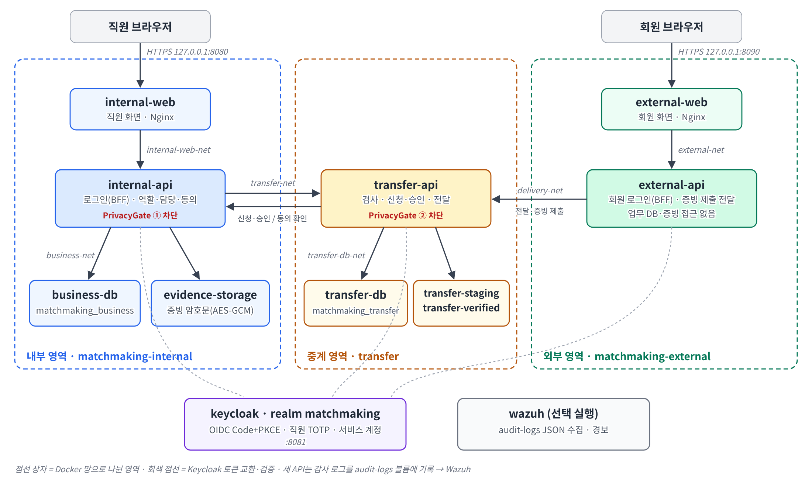

# PrivacyGate — 결혼정보회사 개인정보 접근·반출 통제 모듈

> 가상 결혼정보회사 **'이음'** 을 무대로, 회원 증빙자료(신분증·학력·혼인관계·소득 등)가
> **내부 직원의 권한 남용**과 **외부 회원의 요청 변조**가 이어진 연계 공격으로 새어 나가는 것을 막는 보안 모듈입니다.
> 2인 팀 프로젝트 (정보보호 및 보안, 2026) · 모든 회원·서류·연락처는 **합성 데이터**입니다.



## 무엇을 막는가

| 단계 | 공격 | 차단 지점 | 통제 없을 때 (baseline) | PrivacyGate (enforce) |
| --- | --- | --- | --- | --- |
| ① 내부 | 상담 직원이 자기 세션으로 관리자 전용 "전체 회원 내보내기" API 직접 호출 | internal-api 역할 검사 (총관리자만) | 200, 전체 회원 파일 생성 | 403 `ACCESS_DENIED`, 파일 미생성 |
| 연결 | 만든 파일을 반출 대기에 올리고 파일 ID를 외부 공범 회원에게 전달 | 검사와 승인 분리 (신청자 ≠ 승인자) | 승인 없이 대기 | 승인 없으면 전달 대상 아님 |
| ② 외부 | 공범 회원이 자기 정상 다운로드 요청의 `file_id` 를 받은 값으로 바꿈 | transfer-api: 승인 파일(ID·버전·해시)·수신자·동의·만료 재검증 | 비승인 파일 반환 | 403 `APPROVAL_MISMATCH`, 자료 미반환 |

같은 경로를 `.env` 의 `GATE_MODE`(enforce / baseline)로 바꿔 **같은 요청의 결과와 감사 로그·Wazuh 경보를 비교**합니다.

## 핵심 보안 설계

- **망 분리**: 내부(직원) · 중계 · 외부(회원) 영역을 Docker 내부망으로 나누고, 외부 API는 업무 DB·증빙 저장소와 망을 공유하지 않습니다. 두 영역 사이는 중계 서버(transfer-api) 하나뿐입니다.
- **BFF 인증**: Keycloak(OIDC, Authorization Code + PKCE) 토큰은 서버가 보관하고, 브라우저에는 HttpOnly·Secure·SameSite=Strict 세션 쿠키만 줍니다. 상태 변경 요청은 CSRF 토큰과 Origin을 검사합니다.
- **기본 거부**: 모든 `/api` 경로에 허용 역할을 선언하고, 선언 없는 경로가 있으면 서버가 시작하지 않습니다. 역할은 매 요청 DB에서 다시 읽습니다.
- **직무 분리**: 총관리자에게 반출 승인 권한이 없고, 승인 담당자에게 내보내기·원본 열람 권한이 없으며, 신청자와 승인자가 같으면 거부합니다. 직원 가입은 총관리자 승인을 거칩니다.
- **서버 간 이중 토큰**: 외부 → 중계 → 내부 호출은 서비스 토큰과 회원(또는 직원) 토큰을 함께 검증하고, `trace_id` 로 세 서버의 로그를 하나로 잇습니다.
- **증빙 보호**: 원본은 AES-GCM으로 암호화해 내부에만 두고, 로컬 OCR 자동 검사(개인정보 탐지·발급대장 대조·마스킹 사본)와 직원 심사 후 **요약(구간·여부)과 마스킹 사본만** 승인 절차를 거쳐 전달합니다. 원본은 보존 기간이 지나면 자동 삭제됩니다.
- **매칭 단계 통제**
  - 매칭 필수 조건: 신분증·학력·프로필 사진·혼인관계증명서 심사 통과 (서버가 판단)
  - 모든 공개 항목은 회원 동의 + 담당 직원 요청 + 별도 승인 담당자 승인 후에만 상대에게 보임
  - **상호주의 공개**: 이름·사진·소득·부동산·연락처는 같은 항목을 서로 공개해야만 전달 (한쪽만 공개해 상대 정보를 모으는 수집 공격 차단). 요청·승인·다운로드마다 다시 확인
  - 연락처는 만남 일정 확정 + 상호 동의까지 필요, 소개글에 연락 수단(전화·이메일·링크·메신저 아이디)을 쓰면 저장 거절
- **감사·관제**: 모든 허용·거부를 허용 필드만 담은 JSON 한 줄로 기록하고, Wazuh 규칙이 공격 ①② 패턴과 같은 계정의 반복 거부를 경보합니다.

자세한 설계: [아키텍처 설계](matchmaking-internal/docs/architecture.md) · [내부 API 명세](matchmaking-internal/docs/api-spec.md) · [외부·중계 API 명세](matchmaking-external/docs/api-spec.md) · [권한표](matchmaking-internal/docs/permissions.md)

## 구성

| 폴더 | 내용 | 기술 |
| --- | --- | --- |
| [`privacygate/`](privacygate) | 공통 보안 패키지(`src/privacygate`: 역할·직무 분리·세션/CSRF·감사 로그·승인 파일 검증·기본 거부 가드), 전체 실행 환경(Docker Compose·망 분리), DB 스키마·SECURITY DEFINER 함수, Keycloak realm, Wazuh 규칙, 시연·배포 스크립트 | Python, PostgreSQL 16, Keycloak 26, Wazuh 4 |
| [`matchmaking-internal/`](matchmaking-internal) | 직원 업무 시스템: internal-api(업무 API·직원 BFF·증빙 암호화·심사), internal-web(직원 화면), doc-inspector(로컬 OCR 자동 검사) | FastAPI, HTML/JS, Nginx, Tesseract |
| [`matchmaking-external/`](matchmaking-external) | 회원 서비스와 중계: external-api(회원 BFF), transfer-api(반출 검사·승인·전달, 유료 매칭·만남 일정), external-web(회원 화면) | FastAPI, HTML/JS, Nginx |

```
                 ┌──────────── 내부 영역 ────────────┐   ┌─ 중계 ─┐   ┌──── 외부 영역 ────┐
직원 브라우저 ─▶ internal-web ─▶ internal-api ─▶ business-db │   │        │   │                  │
                 │                  │  └▶ doc-inspector   │   │transfer│◀─ external-api ◀─ external-web ◀─ 회원 브라우저
                 │                  └──────────────────────┼──▶│  -api  │   │                  │
                 └──────────────────────────────────────────┘   └───┬────┘   └──────────────────┘
                                         Keycloak (OIDC) · Wazuh (감사 로그 수집·경보)
```

## 실행

Docker Desktop이 필요합니다. 이 저장소를 받은 뒤:

```bash
cd privacygate
./infra/scripts/init-env.sh                 # .env·TLS 인증서·증빙 암호화 키를 무작위로 생성 (Git 제외)
cd ../matchmaking-external
python3 scripts/initialize.py               # 세션 암호화 키·internal-admin client 비밀값 (.local/, Git 제외)
composeArgs=(--project-directory ../privacygate --env-file ../privacygate/.env --env-file ./.local/internal-admin.env \
  -f ../privacygate/compose.yaml -f ./compose.external.yaml -f ./compose.member-lifecycle.yaml --profile external)
docker compose "${composeArgs[@]}" up -d --build
cd ../privacygate
./infra/scripts/link-seed-accounts.sh apply          # 시드 회원 20명 로그인 계정 (member_001~020)
./infra/scripts/mark-required-evidence.sh A-001 A-002 A-004   # (시험용) 매칭 필수 증빙 승인 기록
```

| 주소 | 용도 |
| --- | --- |
| https://localhost:8080 | 직원 화면 (`counselor_a`, `counselor_b`, `approver`, `data_admin`) |
| https://localhost:8090 | 회원 화면 (`member_b`, `member_001` …) |
| https://localhost:8081 | Keycloak |

시험 계정 비밀번호는 생성된 `.env` 의 `KC_TEST_PASSWORD` 입니다. 시험 기록 정리: `./infra/scripts/reset-test-data.sh check-keep` → `apply-keep`.
인터넷 경유 시연(외부 PC = 공격자 역할)은 [Tailscale Funnel 배포](privacygate/infra/funnel/README.md)로 회원 화면·회원 로그인만 공개하고 직원 화면·Keycloak 관리·Wazuh는 비공개로 둡니다.

## 시험

```bash
# 공통 보안 패키지
cd privacygate && pip install -e ".[web]" && python -m unittest discover -s tests -v
# 외부·중계 (통합 시험 + 화면 로직)
cd matchmaking-external && python -m pytest -q tests/integration && node --test tests/frontend/*.cjs
# 내부 (실행 중인 스택에서 권한 동작)
docker compose exec -T internal-api python - < ../matchmaking-internal/tests/test_permissions.py
```

## 시연 결과

> 공격 시나리오 ①② 를 baseline / enforce 로 실행한 응답·파일 상태·감사 로그·Wazuh 경보 비교를 여기에 추가합니다.

## 역할

| 팀원 | 담당 |
| --- | --- |
| 이세빈 ([@sebinlee0731](https://github.com/sebinlee0731)) | 아키텍처 설계, 공통 보안 패키지·실행 환경·DB, 내부 업무 시스템(internal-api·internal-web·doc-inspector), 매칭 통제 규칙, 문서 |
| 한은결 | 회원 서비스·중계 서버(external-api·transfer-api·external-web), Wazuh 연동 |

원본 저장소: [privacygate-matchmaking](https://github.com/privacygate-matchmaking) 조직의 `privacygate`, `matchmaking-internal`, `matchmaking-external` 를 한곳에 모은 포트폴리오용 사본입니다.

## 주의

- 모든 회원 이름·연락처·서류는 합성 데이터이며 실존 인물·기관과 관계없습니다.
- `.env`, `infra/secrets/`, 증빙 저장소, 감사 로그, 시연 증거(`evidence/`)는 저장소에 포함하지 않습니다.
- 교육용 시제품이며 실제 서비스 운영용이 아닙니다.
